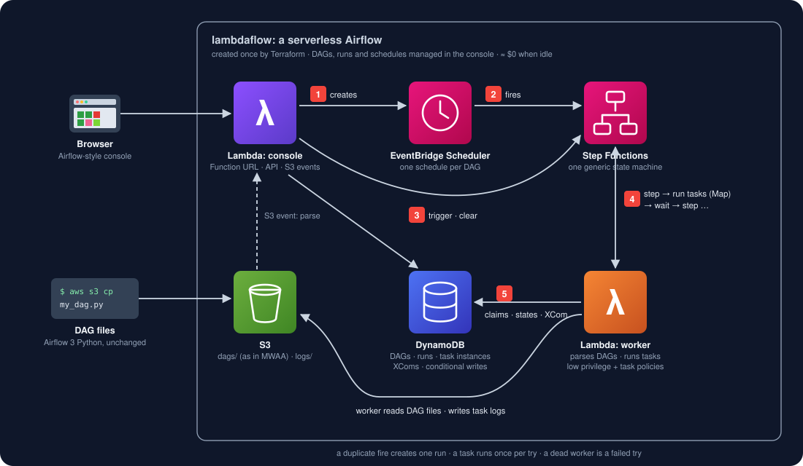

# lambdaflow — a truly serverless Airflow

> **Amazon MWAA** bills for its environment every hour, also when no DAG runs. **lambdaflow** runs the same
> Airflow 3 DAG files on **Lambda, Step Functions, EventBridge Scheduler, DynamoDB and S3** and costs ≈ $0
> when nothing happens. Same DAG files; when you outgrow it, copy them to MWAA and nothing else changes.

[中文](README.zh.md) · [compatibility report](tests/compat/REPORT.md) · [tasks](tests/compat/TASKS.md) · [changelog](CHANGELOG.md)



| | Amazon MWAA | MWAA Serverless | lambdaflow |
|---|---|---|---|
| Idle cost / month | per environment-hour, around the clock (a small environment ≈ $358/month in us-east-2, [AWS](https://aws.amazon.com/blogs/compute/automating-stopping-and-starting-amazon-mwaa-environments-to-reduce-cost/)) | ≈ $0, per task-minute | ≈ $0 |
| DAG files | Python, any operator | YAML (DAG factory), Amazon provider operators ([AWS docs](https://docs.aws.amazon.com/mwaa/latest/mwaa-serverless-userguide/what-is-mwaa-serverless.html)) | Python, Airflow 3 (`airflow.sdk`), the standard operators |
| Where DAGs live | S3 `dags/` | S3, snapshotted per version | S3 `dags/`, parsed on upload |
| Scheduler | Airflow scheduler | AWS managed | EventBridge Scheduler, one schedule per DAG |
| UI | Airflow UI | none (CloudWatch) | built-in Airflow-style console (Lambda URL) |
| Metadata | Aurora (AWS managed) | AWS managed | one DynamoDB table |
| Airflow compatibility | 100% | — | [see the report](tests/compat/REPORT.md) |

## Why

Most Airflow installations run a handful of DAGs a few times a day; the rest of the time the scheduler, web
server and database sit idle and MWAA bills for them anyway. A DAG run is a short burst of work — exactly what
Lambda and Step Functions are priced for. lambdaflow keeps what people like about Airflow (DAG files in
Python, `>>`, TaskFlow, trigger rules, retries, XCom, Jinja templates, the grid view) and drops the servers.

## How it works

You upload a DAG file to the console (or `aws s3 cp` it to `dags/`, as in MWAA). The **worker** Lambda —
the only code that imports DAG files — parses it with lambdaflow's own `airflow` package and stores the DAG
in **DynamoDB**; arguments lambdaflow does not support are refused right there, as the file's import error.
The **console** Lambda creates one **EventBridge Scheduler** schedule per DAG (`0 6 * * 1-5` becomes
`cron(0 6 ? * MON-FRI *)`, timezone from `start_date`). When it fires, or when you trigger a run, one
execution of a single generic **Step Functions** state machine loops: *step* (the worker applies Airflow's
trigger rules and claims the tasks that can run) → *run tasks* (a Map, one worker invocation per task) →
*wait* (only for retries) → *step* … Every state change is a conditional DynamoDB write, so a schedule that
fires twice creates one run and no task runs twice. Task logs go to **S3** in Airflow's log layout.

## Quick start

### 1. Deploy (Terraform)

```bash
cp terraform/example.json terraform/my.json      # aws_profile, env, console_auth_username, console_auth_password; task_policy_arns for your tasks
terraform -chdir=terraform init
terraform -chdir=terraform apply -var-file=my.json
terraform -chdir=terraform output                 # console_url, dags_folder
terraform -chdir=terraform destroy -var-file=my.json   # tear everything down (DAG files and logs too)
```

The apply runs `pip` once on your machine to build the Lambda layer (jinja2, tzdata). CloudFormation: not yet.

### 2. Open the console

Open `console_url`, sign in with `console_auth_username` / `console_auth_password`. The DAG list (pause switch, schedule, next run,
recent runs, import errors) and each DAG's **Grid**, **Graph**, **Code** and **Details** views look like the
Airflow UI; click a square for the task's log, XCom, **Clear** and **Mark success / failed**. Upload or
write DAG files in the browser. The command box takes airflow CLI commands: `dags trigger my_dag -c '{"x": 1}'`,
`dags list-runs my_dag`, `tasks states-for-dag-run my_dag <run_id>` (`help` lists them).

### 3. Write DAGs as for Airflow 3

```python
import datetime
from airflow.sdk import DAG, task
from airflow.providers.standard.operators.bash import BashOperator

with DAG("my_dag", start_date=datetime.datetime(2026, 1, 1, tzinfo=datetime.timezone.utc),
         schedule="0 6 * * *", params={"name": "world"}):

    @task
    def extract():
        return {"rows": 42}

    @task
    def load(data, params=None):
        print(f"loading {data['rows']} rows for {params['name']}")

    load(extract()) >> BashOperator(task_id="report", bash_command="echo 'done for {{ ds }}'")
```

```bash
aws s3 cp my_dag.py "$(terraform -chdir=terraform output -raw dags_folder)"   # or upload in the console
```

From Python (CI, scripts): `pip install lambdaflow`, then `client.connect(console_url, user, password)` —
`upload`, `trigger`, `wait`, `log`, `clear`, `cli("dags list")`; see [client/README.md](client/README.md).

New DAGs start paused, as in Airflow. What your tasks may touch in AWS is granted in Terraform only
(`task_policy_arns`), never from the console.

### Locally, without AWS

```bash
pip install boto3 moto jinja2
python3 src/server/dev.py my_dags/        # http://127.0.0.1:8080, admin / admin; AWS mocked in memory
```

The same console, worker and planner; the state machine is a thread, EventBridge a timer.

## Compatibility

[tests/compat/REPORT.md](tests/compat/REPORT.md) is regenerated by every test run: the same DAG files run on a
real Airflow 3.3.1 (Docker) and on lambdaflow, comparing every task's state and try number, every XCom value
and, for schedules, the first run after `start_date`. The report also lists which test covers which
business step, including what can only be checked after a deploy.

| Status | Meaning |
|---|---|
| ✅ verified | identical to Airflow; safe to rely on |
| ❌ gap | known difference; the note names the task in [TASKS.md](tests/compat/TASKS.md) that closes it |
| ⚪ quirk | documented difference we deliberately keep (e.g. `schedule=timedelta`: EventBridge picks the phase) |
| ⛔ unsupported | refused with `NotSupportedError` when the file is parsed — never silently different |

Supported today: `DAG` / `@dag` / `@task` (`.branch`, `.short_circuit`), `>>` / `<<`, PythonOperator,
BranchPythonOperator, ShortCircuitOperator, BashOperator, EmptyOperator, all trigger rules, retries and
retry_delay, XCom (incl. `multiple_outputs`), params and `dag_run.conf`, Jinja templates (`ds`, `ts`,
`logical_date`, `macros.ds_add` …), cron / presets / `@once` / `timedelta` schedules with timezones,
`max_active_runs`. Not supported — the file fails to parse and the console shows why: pools, sensors and
deferrable operators, dynamic task mapping, dataset / asset schedules, `catchup=True`; tasks are also
limited to 15 minutes (`task_timeout`).

```bash
python3 -m pytest tests -q                 # leaves Docker alone: live if Airflow is running, else the recorded outcomes
python3 -m pytest tests -q --docker up     # starts Airflow 3.3.1 in Docker, waits until healthy, tests; keeps it running
python3 -m pytest tests -q --docker run    # the same, then stops it if all passed (on a failure it keeps running)
python3 -m pytest tests -q --docker down   # the same, then stops it whatever the result
```

## Guarantees

| | How |
|---|---|
| **One run per schedule tick** | the run id (`scheduled__<time>`) is a conditional write; a duplicate fire is dropped |
| **A task runs once per try** | a task is claimed with a conditional write before it runs; a second loop on the same run cannot claim it |
| **Durability** | every state change is a DynamoDB write before the next step; task logs are in S3 |
| **A dead worker is a failed try** | a Lambda timeout or crash is caught by the state machine and retried like any task failure |
| **Least privilege** | only the worker runs your code; it can read DAG files, write logs and its own table items, plus `task_policy_arns` |
| **Availability** | Lambda, Step Functions, EventBridge, DynamoDB and S3 are regional, multi-AZ services: nothing to patch |

## Who this is for

Teams with tens of DAGs that run hourly or daily, made of Python and Bash tasks that finish within minutes —
ETL glue, reports, housekeeping. Not for: tasks longer than 15 minutes, sensors that wait for hours,
hundreds of parallel tasks, or provider operators beyond the standard ones. That is the moment to move to
MWAA — see [MIGRATION.md](MIGRATION.md).

## Repository layout

```
src/server/       lambda_function.py (console + API), worker.py (runs DAG code), engine.py (planner),
                  schedule.py (cron → EventBridge), airflow/ (the Airflow 3 authoring API), index.html, dev.py
terraform/        deployment
cloudformation/   (not yet)
tests/            regression suite; tests/compat/ compatibility suite, REPORT.md, TASKS.md
```

## Releasing

CI runs the whole suite on every push. A release is a tag: bump the version in `client/pyproject.toml` and
`client/lambdaflow/__init__.py`, add the CHANGELOG entry, commit, then `git tag vX.Y.Z && git push --tags`
(tests → build → PyPI trusted publishing; the tag must equal the version).

---

Part of **[Redefine AWS Serverless](https://github.com/topics/redefine-aws-serverless)** — AWS services that bill
while idle, rebuilt on primitives that cost ≈ $0 when idle. MIT.
